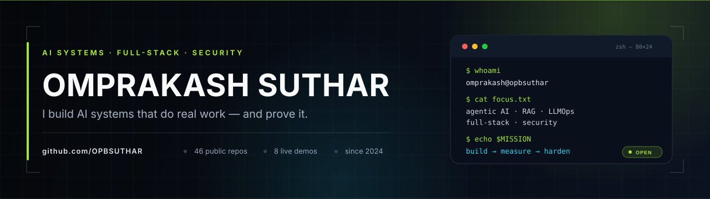

  

  
  
  
  

  
  
  
  

## The short version

I build **AI systems that do real work — and prove it.**

Most AI demos stop at a chat box. I care about what happens next: the tool call that has to be validated, the retrieval result that has to be cited, the confidence score that triggers a review, the approval gate that stops a bad booking, and the trace that explains why the system did what it did.

My work sits at the intersection of **agentic AI, full-stack product engineering, and security**. I like problems where software has to make a decision in the real world — freight operations, public safety, infrastructure, finance, identity — and where “it works” is not enough unless you can also show *how* it works.

> **Now:** shipping agentic systems with human-in-the-loop controls, building **Omnia** — one local-first app for every device — and exploring AI for Indian satellites through [Agnirva NEAT 5.0 / Satora](https://github.com/OPBSUTHAR/Satora).

**Pick your path:**

| You're here to | Start here |
| --- | --- |
| **Hire or collaborate** | [Featured systems](#featured-systems) · [Tech stack](#tech-stack) · [Email me](mailto:omprakashsuhar@gmail.com) |
| **See something running** | [FreightOps AI](https://freightops-ai.vercel.app) · [SentinelVault](https://sentinelvault-pearl.vercel.app) · [CrimeIntel](https://crimeintel-commandcenter.vercel.app) · [Omnia](https://opbsuthar.github.io/orbisnova/) |
| **Go deep** | [How I build](#how-i-build) · [Full project index](#full-project-index) · [GitHub](https://github.com/OPBSUTHAR) |

---

## Featured systems

<table>
<tr>
<td width="50%" valign="top">

<h3><a href="https://freightops-ai.vercel.app">FreightOps AI ↗</a></h3>

<strong>Agentic freight operations control tower.</strong>

Planner → executor → reviewer agents quote, book, track and resolve exceptions — with retrieval over tariffs and SOPs, per-step traces, 9 behavioral evals, and a hard human-approval gate.

<code>Python</code> <code>FastAPI</code> <code>React</code> <code>RAG</code> <code>LLMOps</code>

<a href="https://freightops-ai.vercel.app">Live demo</a> · <a href="https://github.com/OPBSUTHAR/freightops-ai">Source</a>

</td>
<td width="50%" valign="top">

<h3><a href="https://sentinelvault-pearl.vercel.app">SentinelVault ↗</a></h3>

<strong>Zero-knowledge password manager with a security brain.</strong>

AES-256-GCM vault + Argon2id key derivation, HIBP k-anonymity breach checks, password-health scoring, TOTP 2FA, secure sharing, phishing detection, and a Chrome auto-fill extension.

<code>Python</code> <code>FastAPI</code> <code>React</code> <code>Security</code>

<a href="https://sentinelvault-pearl.vercel.app">Live demo</a> · <a href="https://github.com/OPBSUTHAR/SentinelVault">Source</a>

</td>
</tr>
<tr>
<td width="50%" valign="top">

<h3><a href="https://crimeintel-commandcenter.vercel.app">CrimeIntel Command Center ↗</a></h3>

<strong>Conversational crime intelligence for Karnataka State Police.</strong>

CRIMA AI assistant, case explorer, analytics, evidence views and heat maps over a FastAPI + React stack, with Sentence Transformers and FAISS retrieval for grounded answers.

<code>FastAPI</code> <code>React</code> <code>TypeScript</code> <code>FAISS</code>

<a href="https://crimeintel-commandcenter.vercel.app">Live demo</a> · <a href="https://github.com/OPBSUTHAR/CrimeIntel-CommandCenter">Source</a>

</td>
<td width="50%" valign="top">

<h3><a href="https://aerogrid-safetynlp.vercel.app">AeroGrid SafetyNLP ↗</a></h3>

<strong>Safety-incident intelligence for aviation and power grids.</strong>

TF-IDF/SGD classification over NASA ASRS and NERC-style reports, RAG explanations with evidence cards, live critical alerts, and a local Ollama analyst — no paid API required.

<code>Python</code> <code>scikit-learn</code> <code>RAG</code> <code>Ollama</code>

<a href="https://aerogrid-safetynlp.vercel.app">Live demo</a> · <a href="https://github.com/OPBSUTHAR/AeroGrid-SafetyNLP">Source</a>

</td>
</tr>
<tr>
<td width="50%" valign="top">

<h3><a href="https://railway-management-system-nine.vercel.app">RailSetu ↗</a></h3>

<strong>A full railway booking and operations product.</strong>

22 curated services, 39+ stations, class/fare comparison, a 48-seat coach map, waitlist handling, printable e-tickets, and a live route map with simulated train position.

<code>React</code> <code>Vite</code> <code>Leaflet</code> <code>Product</code>

<a href="https://railway-management-system-nine.vercel.app">Live demo</a> · <a href="https://github.com/OPBSUTHAR/railway-management-system">Source</a>

</td>
<td width="50%" valign="top">

<h3><a href="https://my-byte.vercel.app">MyByte ↗</a></h3>

<strong>A portfolio that behaves like a product.</strong>

React SPA with a real terminal, 14 XP achievements, Konami-code arcade mode, GSAP scroll storytelling, pointer-reactive physics, and a Python pipeline that keeps the project data live.

<code>React</code> <code>GSAP</code> <code>Python</code> <code>Creative dev</code>

<a href="https://my-byte.vercel.app">Live demo</a> · <a href="https://github.com/OPBSUTHAR/MyByte">Source</a>

</td>
</tr>
<tr>
<td width="50%" valign="top">

<h3><a href="https://opbsuthar.github.io/orbisnova/">Omnia ↗</a></h3>

<strong>One app, every device — local-first.</strong>

A cross-platform super-app built with Expo and React Native: one TypeScript codebase for web, PWA and Android, with a local-first data layer and live in-app update alerts.

<code>TypeScript</code> <code>Expo</code> <code>React Native</code> <code>PWA</code>

<a href="https://opbsuthar.github.io/orbisnova/">Live demo</a> · <a href="https://github.com/OPBSUTHAR/orbisnova">Source</a>

</td>
<td width="50%" valign="top">

<h3><a href="https://autonomous-data-annotator.vercel.app">Autonomous Data Annotator ↗</a></h3>

<strong>Drop a file, get structure back.</strong>

A reactive full-stack annotator that labels any file type — documents, images, records — through an automated annotation pipeline, with a live review surface instead of a black box.

<code>TypeScript</code> <code>Next.js</code> <code>Automation</code>

<a href="https://autonomous-data-annotator.vercel.app">Live demo</a> · <a href="https://github.com/OPBSUTHAR/autonomous-data-annotator">Source</a>

</td>
</tr>
</table>

Also live: <a href="https://opbsuthar.github.io/BharatVista-Nexus/">BharatVista Nexus</a> — an open-data map in pure C + SQLite · <a href="https://opbsuthar.github.io/login-template/">Login Template</a> — my first Git project, still standing.

---

## Tech stack

The working inventory — languages I write, skills I build with them, and the tools I live in.

**Languages**

**AI / data**

**Backend / frontend**

**Data stores / delivery**

### Language stack

| Tier | Languages |
| --- | --- |
| **Core priorities** | `C` `C++` `C#` `HTML` `CSS` `JavaScript` `Python` `Java` |
| **Framework & data syntax** | `TypeScript` `SQL` |
| **Automation** | `AutoHotkey` |

### Skill stack

| Area | What I actually use it for |
| --- | --- |
| **Full-stack & web** | `MERN (MongoDB, Express, React, Node.js)` `MEAN` `Tailwind CSS` `REST APIs` |
| **Backend & systems** | `Spring Boot` `Flask` `Streamlit` `.NET WinForms` `PyQt` `Jetpack Compose` |
| **Data & AI engineering** | `Data-engineering pipeline integration` `API integration` `RAG (Retrieval-Augmented Generation)` `NLP` `OCR text extraction` `Edge detection & perspective dewarping` |
| **Database management** | `MySQL` `PostgreSQL` `MongoDB` `SQLite` `InfluxDB` `Neo4j` `Supabase` `Redis` |
| **Specialised domains** | `GIS / Leaflet mapping` `Space telemetry & debris tracking` `3D character animation — NPR cel-shading & Grease Pencil in Blender` |

### Tool stack

| Layer | Tools |
| --- | --- |
| **IDEs & code environments** | `VS Code` `Visual Studio Insiders` `Android Studio` `Eclipse IDE` `IntelliJ IDEA` |
| **Local & cloud AI agent frameworks** | `Ollama` `OpenCode CLI` `Hermes Agent` `OpenClaw` `CrewAI` `LangChain` `Hugging Face Transformers` `PyTorch` `NLTK` `spaCy` `NumPy` `Pandas` |
| **DevOps, CLI & developer utilities** | `Git / GitHub` `Docker` `PSReadLine terminal predictions` `AutoHotkey automation` |
| **Hardware & IoT prototyping** | `Tinkercad (Arduino, sensors, modules)` `LoRa` |

Also on the desk: Ollama running fully local with a custom model store, Blender for NPR cel-shaded character work, and a terminal configured to finish my commands before I do.

---

## How I build

| Principle | What it looks like in practice |
| --- | --- |
| **Start with the decision** | Before the model, define the action, the risk, and who must approve it. A human gate is a product requirement, not a failure state. |
| **Evidence over output** | Retrieval should cite its sources. Extraction should show confidence. A recommendation without a reason is just a guess with better branding. |
| **Guardrails in code** | Margin floors, spend caps, carrier/document confidence thresholds, PII redaction and prompt-injection quarantine belong in the runtime — not in a prompt that hopes. |
| **Evals are the product** | Behavioral tests, traces, latency and spend telemetry. If the system can’t be measured, it isn’t ready to be trusted. |
| **Make it legible** | The best interface shows what happened, what happens next, and how to intervene. Calm beats clever. |

---

## Currently

- **Building:** agentic systems with explicit approval gates and measurable failure modes.
- **Shipping:** [Omnia](https://github.com/OPBSUTHAR/orbisnova) — one local-first app for every device — and an [autonomous annotator](https://github.com/OPBSUTHAR/autonomous-data-annotator) for any file type.
- **Exploring:** AI for Indian satellites through [Satora](https://github.com/OPBSUTHAR/Satora) / Agnirva NEAT 5.0.
- **Sharpening:** evaluation harnesses, observability, model routing and retrieval quality.
- **Open to:** AI/platform engineering roles and collaborations where reliability matters.

---

## Full project index

<strong>Open the index — all 48 public repositories</strong>

### AI systems, agents & applied ML

- [FreightOps AI](https://github.com/OPBSUTHAR/freightops-ai) — multi-agent freight control tower with RAG, evals and a human gate. `Python · FastAPI · React`
- [SentinelVault](https://github.com/OPBSUTHAR/SentinelVault) — zero-knowledge password manager with breach monitoring, TOTP and phishing detection. `Python · FastAPI · React`
- [CrimeIntel Command Center](https://github.com/OPBSUTHAR/CrimeIntel-CommandCenter) — conversational crime intelligence for KSP; cases, analytics, evidence and heat maps. `FastAPI · React · FAISS`
- [AeroGrid SafetyNLP](https://github.com/OPBSUTHAR/AeroGrid-SafetyNLP) — aviation and power-grid incident classification with RAG explanations and live alerts. `Python · scikit-learn · Ollama`
- [Satora](https://github.com/OPBSUTHAR/Satora) — Agnirva NEAT 5.0 work on AI for Indian satellites; BRD and research artifacts. `Python · Research`
- [SUTHARA AI](https://github.com/OPBSUTHAR/SUTHARA_AI) — omni-interactive assistant with Streamlit, Ollama, vision and voice. `Python · Streamlit · Ollama`
- [Autonomous Data Annotator](https://github.com/OPBSUTHAR/autonomous-data-annotator) — reactive full-stack app that annotates any file type. `Next.js · TypeScript`
- [AI Scanner](https://github.com/OPBSUTHAR/ai-scanner) — document scanner with edge detection, OCR, classification and cloud sync. `OpenCV · Tesseract · Flask`
- [SynchroGroundedNet](https://github.com/OPBSUTHAR/SynchroGroundedNet) — infrastructure safety concept spanning space and power systems. `TypeScript · AI Studio`
- [Krishi-Gati AI](https://github.com/OPBSUTHAR/Krishi-Gati-AI) — agriculture-focused AI interface. `JavaScript`
- [Delhivery Pipeline](https://github.com/OPBSUTHAR/delhivery-pipeline) — logistics data-pipeline experiments. `Python`
- [Data Engineering](https://github.com/OPBSUTHAR/data-enginnering) — data-engineering practice builds. `Python`
- [Salary Prediction](https://github.com/OPBSUTHAR/salary-prediction) — ML salary-prediction web app. `HTML · ML`
- [Sarathi LL Face Simulator](https://github.com/OPBSUTHAR/sarathi-ll-face-simulator) — OpenCV face-authentication simulator with live oval guide and match scoring. `Python · OpenCV`
- [Aviation NLP Project](https://github.com/OPBSUTHAR/Aviation_NLP_Project) — reference fork behind the AeroGrid safety NLP work. `Python · Fork`
- [CrimeIntel AI](https://github.com/OPBSUTHAR/crimeintel-ai) — earlier reference fork for the CrimeIntel platform. `Python · Fork`

### Full-stack products & interfaces

- [Orbisnova / Omnia](https://github.com/OPBSUTHAR/orbisnova) — local-first cross-platform super-app; one TypeScript codebase for web, PWA and Android. `Expo · React Native · TypeScript`
- [RailSetu](https://github.com/OPBSUTHAR/railway-management-system) — railway booking and operations app with seat maps and live tracking. `React · Leaflet`
- [MyByte](https://github.com/OPBSUTHAR/MyByte) — gamified portfolio with terminal, XP, arcade mode and motion design. `React · GSAP`
- [DataZen](https://github.com/OPBSUTHAR/DataZen) — data-focused web build. `HTML`
- [AstraForge](https://github.com/OPBSUTHAR/AstraForge) — TypeScript product experiment. `TypeScript`
- [Agri360](https://github.com/OPBSUTHAR/Agri360) — agriculture interface built with React and Vite. `React · Vite`
- [BioSite](https://github.com/OPBSUTHAR/BioSite) — personal bio/portfolio site. `CSS`
- [Ledgerly](https://github.com/OPBSUTHAR/ledgerly) — finance/ledger app experiment. `Web`
- [SpaceFlightMonitor](https://github.com/OPBSUTHAR/SpaceFlightMonitor) — spaceflight tracking interface. `JavaScript`
- [Econnect](https://github.com/OPBSUTHAR/Econnect) — connection-focused web app. `HTML`
- [Gym Management System](https://github.com/OPBSUTHAR/gym-management-system) — gym operations interface. `HTML`
- [Catering Reservation & Order System](https://github.com/OPBSUTHAR/catering-reservation-and-order-system) — catering booking and orders. `HTML`
- [Student–Teacher Appointment Booking](https://github.com/OPBSUTHAR/student-teacher-appointment-booking) — appointment scheduling app. `JavaScript`
- [EV Recharge Bunk](https://github.com/OPBSUTHAR/electric-vehicle-recharge-bunk) — EV charging-station interface. `Web`
- [Student Registration](https://github.com/OPBSUTHAR/student-registration) — Flask registration app. `Python · Flask`
- [Student Tracker](https://github.com/OPBSUTHAR/student-tracker) — student tracking tool. `Python`
- [Priority Scheduler](https://github.com/OPBSUTHAR/priority_scheduler) — scheduling and priority practice build. `HTML`
- [Recipe Book](https://github.com/OPBSUTHAR/recipe-book) — recipe collection app. `JavaScript`
- [To-Do Master](https://github.com/OPBSUTHAR/To-Do-Master) — task manager. `JavaScript`
- [Expense Tracker](https://github.com/OPBSUTHAR/Expense-Tracker) — expense tracking app. `JavaScript`
- [Memory Card Game](https://github.com/OPBSUTHAR/MemoryCardGame) — browser memory game. `HTML`
- [Tic-Tac-Toe](https://github.com/OPBSUTHAR/Tic-Tac-Toe-Game) — classic game build. `CSS`
- [Basic Calculator](https://github.com/OPBSUTHAR/Basic-Calculator) — calculator app. `JavaScript`
- [Countdown Timer](https://github.com/OPBSUTHAR/countdown-timer) — countdown UI. `CSS`

### Systems, security & experiments

- [BharatVista Nexus](https://github.com/OPBSUTHAR/BharatVista-Nexus) — open-data nexus in pure C with SQLite, Leaflet, data.gov.in and Celestrak. `C · SQLite · Leaflet`
- [LockerFactory](https://github.com/OPBSUTHAR/file-lock-app) — secure PDF workspace and AES-GCM file locker. `Python · AES-GCM`
- [LoRa IoT AgriSim](https://github.com/OPBSUTHAR/LoRa_IoT_AgriSim) — LoRa-based agricultural IoT simulation. `IoT · Simulation`
- [Cyber](https://github.com/OPBSUTHAR/cyber) — cybersecurity learning build. `HTML`
- [Project E](https://github.com/OPBSUTHAR/project-E) — Python mini-apps: Neon Dungeon, calculator, expense tracker and Snake. `Python`
- [Cannibals & Missionaries](https://github.com/OPBSUTHAR/cannibals-missionaries) — classic AI search puzzle. `CSS · AI`
- [Login Template](https://github.com/OPBSUTHAR/login-template) — my first Git project, still deployed. `HTML`
- [OPBSUTHAR](https://github.com/OPBSUTHAR/OPBSUTHAR) — this profile’s config and README. `Markdown · SVG`

---

## Let's build something

I’m open to **AI/platform engineering roles**, **agentic product collaborations**, and conversations about **reliable AI systems**.

  
  

   
  <strong>Designed and built by Omprakash Suthar (@OPBSUTHAR).</strong> 
  Build like it will be audited. Ship like it will be used.

